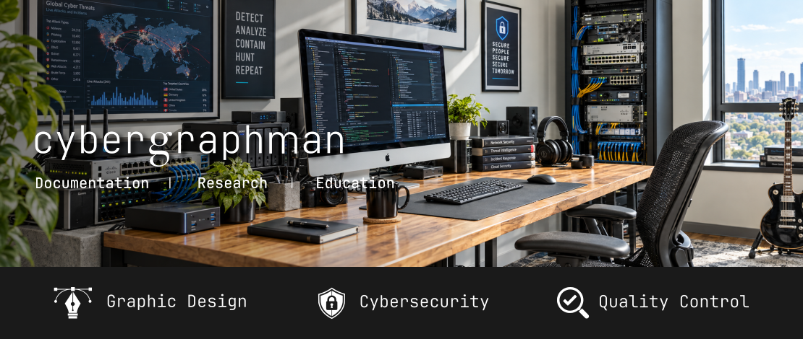

### Cybergraphman

**Graphic Design | Cybersecurity | Quality Control**

Espacio dedicado a compartir conocimientos, documentar herramientas tecnológicas y explorar el mundo del **diseño gráfico, la ciberseguridad y el control de calidad**.

### Repositorios destacados

💻  **[Información del sistema](Sistema/informacion-sistema-macos.md)**  
Apple/macOS/Terminal. Consulta las características de hardware y software.  
📸 **[Conversión de imágenes](Imagenes/conversion-png-jpg.md)**  
Apple/macOS/Terminal. Convierte imágenes PNG a JPEG.  
🎧 **[Conversión de audio](Audio/conversion-wav-mp3.md)**  
Apple/macOS/Terminal. Convierte archivos WAV a MP3 utilizando FFmpeg.

### Credenciales y reconocimientos

📜 **[Asociación Internacional de Ciberseguridad (ASICI)](https://github.com/Cybergraphman/Cybergraphman/raw/refs/heads/main/Credenciales/asici-membresia-2026.pdf)**
